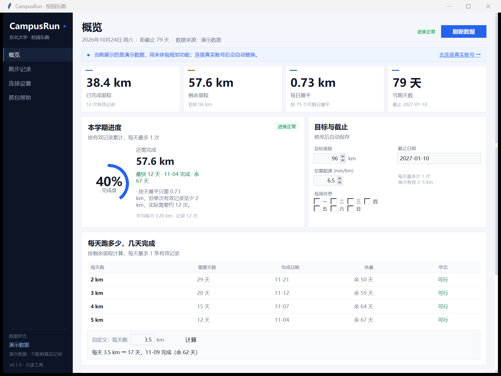
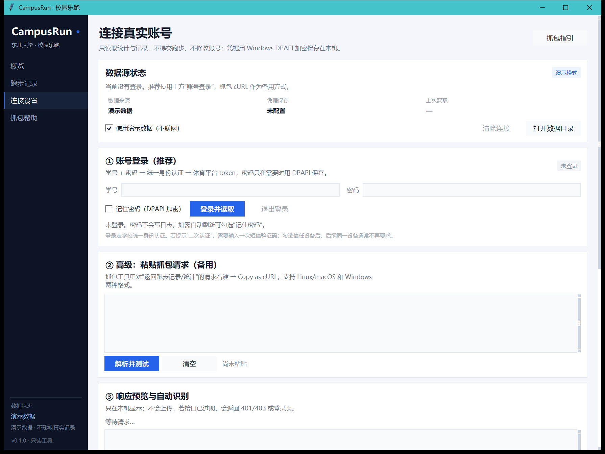

# CampusRun · 东北大学校园乐跑规划器

> **这是发行版 README，面向使用者。**
> 开发文档 / 文件结构 / 协议说明见 [README.dev.md](README.dev.md)。
>
> 版本 0.1.0 · Windows 桌面工具 · 非官方工具

用学号/密码登录东北大学体育平台的“校园乐跑”，读取本学期已跑次数、公里数和逐条记录；
再根据你设定的**目标公里数**、**截止日期**和**每周休息日**，算出每天需要跑多少、
按 2/3/4/5 km 各需要几天，并生成逐日跑步计划。

> 只读工具：只读取统计与记录，不提交跑步、不伪造轨迹、不自动刷里程。
> 请遵守学校体育考核规定，仅用于查询自己的账号。



## 功能

- **账号登录（推荐）**：本机输入学号/密码，通过学校统一身份认证读取校园乐跑数据；
  支持短信二次认证，可选“记住密码”在会话过期后自动重登。
- **抓包登录（备用）**：如果账号登录遇到验证码/风控，可粘贴一条 cURL 复用登录态。
  这个入口默认隐藏，账号登录连续失败 2 次后会自动出现，并提供抓包教程。
- **进度总览**：已跑公里、有效次数、剩余公里、可跑天数、完成度。
- **每日规划**：剩余里程摊到每个可跑日需要多少 km；今天已跑则从明天开始算。
- **完成天数**：每天跑 2 / 3 / 4 / 5 km 分别需要几天、预计哪天完成、离截止日还剩几天。
- **自定义计算**：输入任意每日里程，立即得到天数与完成日期。
- **休息日**：可排除每周固定的休息日（例如周末不跑），可跑日自动重算。
- **逐日计划**：按 2/3/4/5 km 或自定义里程生成完整日程，一键复制。
- **跑步记录**：按日期查看每次里程、用时、配速、有效状态，可导出 CSV。
- **演示模式**：没有真实账号也能体验全部计算功能。

## 运行方式

### 方式一：发行版 EXE（推荐）

1. 下载 `CampusRun-0.1.0-win64.zip`；
2. 解压到任意目录（不要只复制 exe，`_internal` 文件夹要一起保留）；
3. 双击 **`CampusRun.exe`**。

EXE 已内置 Python/Tkinter 运行时，**不需要安装 Python**，也不需要联网安装依赖。

### 方式二：源码运行

- Windows 10 / 11（64 位）；
- Python 3.10 或更高版本，安装时勾选 **Add python.exe to PATH**；
- Python 需要包含 **tkinter**（官方安装包默认包含）；
- 不需要 `pip install` 任何第三方包；
- 保留整个源码文件夹，不要只复制 `run.cmd`。

## 快速开始

1. 解压发行版 zip（或源码文件夹）。
2. 双击 **`CampusRun.exe`**（源码运行则双击 `run.cmd`）。
3. 首次启动是演示数据，可以直接修改目标、截止日期、休息日，熟悉界面。
4. 到“连接设置 → ① 账号登录”：
   - 输入学号；
   - 输入统一身份认证密码；
   - 点 **登录并读取**。
5. 如果学校要求短信二次认证，会弹出输入框，输入手机收到的验证码。
6. 如果首次登录要求绑定邮箱，页面可以点 **“稍后绑定”** 跳过。
7. 登录成功后回到“概览”，在“目标与截止”卡片里设置你的目标 km、截止日期和休息日。

> 第一次登录建议勾选“记住密码”。密码会用 Windows DPAPI 加密保存在本机；
> 会话过期后程序可以自动重新登录。不勾选则只保存 token，过期后需要重新输入密码。

如果只想测试账号能不能登录、不想在本机保存任何内容：

```bat
campusrun.cmd login --no-save
```

它会登录并读取一次数据，然后退出；**不保存密码、token、配置或缓存**。



## 登录说明

### 账号登录

- 走学校统一身份认证（CAS），不会把密码发送给本工具的作者或任何第三方。
- 密码只在本机内存中使用；勾选“记住密码”时用 Windows DPAPI 加密保存，
  只有同一台电脑、同一个 Windows 用户能解密。
- 登录成功后保存体育平台的会话 token；token 失效时用保存的密码自动重登。
- 如果登录时出现短信验证码，输入一次即可；勾选信任设备后，后续通常不再要求。

### 账号登录失败怎么办

- 连续失败 2 次后，程序会自动显示“高级：粘贴抓包请求”备用方式，并询问是否打开抓包教程。
- 抓包方式只需要一条已登录状态的查询请求，具体步骤见
  [抓包指南](docs/CAPTURE.md)。
- 如果学校启用了图形验证码、滑块或扫码登录，账号密码方式可能无法完成，请使用抓包备用方式。

### 抓包备用方式

在抓包工具（Reqable / mitmproxy / Charles 等）中找到返回跑步记录的请求，
右键 **Copy as cURL**，粘贴到程序的“② 高级”卡片，点“解析并测试”，确认次数和公里数后保存。

## 界面说明

### 概览

- **已完成里程 / 剩余里程 / 每日摊平 / 可跑天数**：四个核心数字。
- **本学期进度**：完成度圆环、最快完成天数、预计完成日期。
- **每天跑多少，几天完成**：2/3/4/5 km 的完成天数与完成日期；
  也可以输入任意每日里程，点“计算”。
- **最快完成安排**：逐日安排预览；“查看完整计划”可以换 2/3/4/5 km 并复制计划。

### 记录

按日期倒序列出每次跑步的里程、用时、配速和状态；同一天有多条时按学校规则只取最远一次。
点“导出 CSV”可以把记录保存到数据目录的 `exports` 文件夹。

### 目标与截止

- **目标里程**：本学期需要完成的总公里数（默认 96 km，按学校要求修改）。
- **截止日期**：格式 `YYYY-MM-DD`；可跑天数从今天算到截止日（含两端）。
- **估算配速**：只用于估算用时，默认 6.5 min/km。
- **每周休息**：勾选不跑步的星期，这些天不会计入可跑天数。

修改后自动保存，无需点“保存”。

## 计算口径

学校公开规则（以当期通知为准）：

- 单次有效里程 **2–5 km**；
- 每天最多 **1 条**有效记录；
- 有效配速约 3–10 min/km；
- 每学期里程目标由你设置（默认 96 km）。

工具内部约定：

| 概念 | 定义 |
|---|---|
| 已完成 | 有效记录按“每天只取最远一次”去重后累计 |
| 可跑日 | 今天到截止日（含两端）；今天已有有效记录则从明天开始；再排除每周休息日 |
| 每日摊平 | `剩余里程 ÷ 可跑日数`；低于 2 km 时提示单次下限 |
| 最快天数 | `ceil(剩余里程 ÷ 5)`，每天最多 1 次 |
| “每天 d km”天数 | `ceil(剩余里程 ÷ d)`，最后一天按剩余量跑（不低于 2 km） |

示例：目标 96 km，已完成 38.4 km（12 次），截止 2027-01-10，今天 2026-10-24：

- 剩余 57.6 km，79 个可跑日，摊平 0.73 km/天；
- 最快 12 天，预计 2026-11-04 完成；
- 每天 2 km → 29 天；3 km → 20 天；4 km → 15 天；5 km → 12 天。

如果剩余里程低于 2 km，仍按 1 天计算，并提示最后一天至少跑 2 km（会略微超额）。

## 常见问题

| 问题 | 处理 |
|---|---|
| 双击 `run.cmd` 没反应 | 先看窗口是否一闪而过；在 PowerShell 里运行 `campusrun.cmd doctor` 查看 Python/tkinter 是否可用。 |
| 提示找不到 Python | 安装 Python 3.10+，勾选“Add python.exe to PATH”，重新打开 PowerShell/资源管理器。 |
| 登录提示账号或密码错误 | 先在「智慧东大」App 里确认能登录；注意学号/密码不要带空格。连续失败 2 次会自动显示抓包备用方式。 |
| 登录要求短信验证码 | 正常输入手机收到的验证码；勾选信任设备可减少后续验证。 |
| 提示“首次登录引导”/跳转循环 | 学校 CAS 要求该账号先完成一次网页引导。这个页面通常是**首次绑定邮箱**，页面上可以直接点 **“稍后绑定”** 跳过；完成后关闭浏览器，再回来重新登录。 |
| 登录要求图形验证码/滑块/扫码 | 当前账号登录不支持，请用抓包 cURL 备用方式。 |
| 登录成功但数据为空 | 确认当前学期有有效记录；在校园乐跑页面刷新后再试。 |
| 会话过期 | 勾选“记住密码”可自动重登；否则重新输入密码登录。 |
| 换电脑/换 Windows 账户后要重新登录 | DPAPI 只能在同一台电脑、同一 Windows 用户下解密，重新登录即可。 |
| 想同时保存两个人账号 | 当前版本一次只保存一个账号；第二个账号登录会覆盖第一个。多账号切换尚未加入。 |
| 杀毒软件提示风险 | 程序是 Python 源码 + `.cmd` 启动，不联网上传数据；可以查看源码或加入信任。 |
| 想恢复演示数据 | “连接设置”里勾选“使用演示数据（不联网）”。 |

## 数据与隐私

- 数据目录：`%APPDATA%\CampusRun`（可通过环境变量 `CAMPUSRUN_HOME` 修改）。
- 加密文件：
  - `sports_session.dat`：体育平台会话 token；
  - `credentials.dat`：可选的账号密码；
  - `connection.dat`：可选的抓包 cURL。
  三者都用 Windows DPAPI 加密，换电脑/换 Windows 账户无法解密。
- 密码不写日志、不显示在界面、不进入导出文件。
- 程序只发送查询请求；不提交跑步、不修改成绩、不伪造轨迹。
- 导出的 CSV 只包含日期、里程、用时、配速等记录字段，不包含 token。
- 工具不收集、不上传任何数据。

## 使用边界

- 仅用于查询**自己的**校园乐跑数据；
- 不要用本工具代跑、刷里程或伪造记录；
- 本工具不是学校官方产品，学校规则/接口变化可能导致暂时不可用；
- 使用前请确认符合学校体育考核与账号安全规定。

## 反馈问题

请提供：

- 程序版本（`v0.1.0`）和 Windows 版本；
- 出错时界面/命令行显示的**错误文本**；
- 是否能稳定复现。

**不要发送**学号、密码、token、cURL 原文或 HAR 文件。登录失败时程序会输出脱敏的跳转链，
发那段文本即可。

## 开发者

源码结构、协议说明、构建与测试方式见 [README.dev.md](README.dev.md)。
